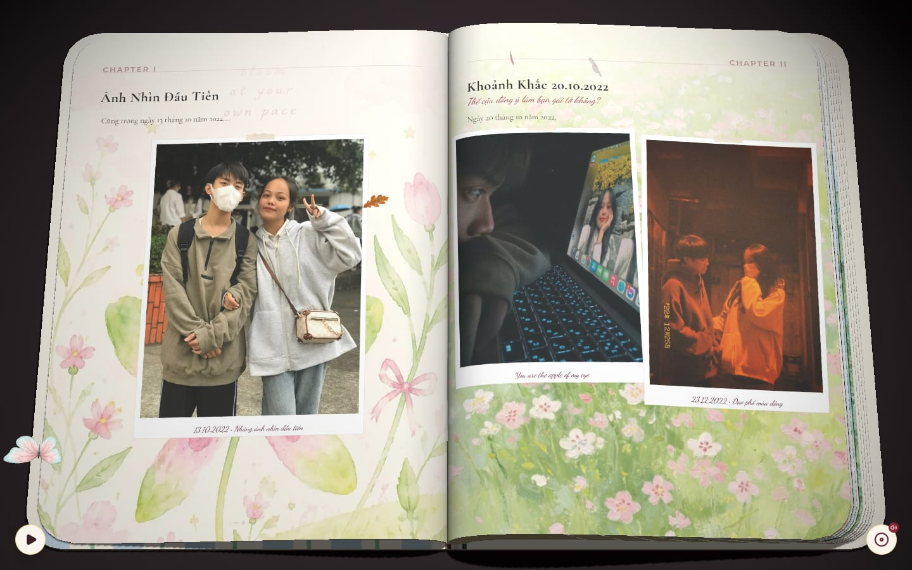

# Phuc & Trang: Love Journal

[](https://github.com/PhucHuwu/PhucandTrang/actions/workflows/ci.yml)


A digital love journal for two people. Visitors read it as an interactive 3D book that turns page by page in the browser. The owner edits it through a private visual editor.

Live site: [love.phuchuwu.io.vn](https://love.phuchuwu.io.vn)



<table>
  <tr>
    <td width="72%"></td>
    <td width="28%"></td>
  </tr>
  <tr>
    <td align="center">Front cover (desktop)</td>
    <td align="center">Mobile</td>
  </tr>
</table>

## Features

**Public 3D journal**
- A WebGL book (Three.js) with realistic page turns. You can turn pages with the mouse, touch, or the keyboard.
- Photos, video clips, and background music, set for the whole book or for individual pages.
- Animated butterflies, petals, and dust around the book. Quality adjusts to the device, so slower hardware still runs smoothly.
- Pages load lazily as the reader moves through the book, and media is preloaded by priority.

**Admin studio**
- A visual page editor (React Konva) with layers, snapping guides, undo/redo, and autosave.
- Editors for the cover, media library, audio library, layout templates, and book settings.
- Edits stay in a draft. A preview mode shows the draft in the real 3D viewer before publishing.
- Before publishing, the content is checked for problems such as missing media or broken links.
- Every publish is saved as a version that you can roll back to.
- Two browser tabs editing the same page cannot silently overwrite each other.

**Security**
- One admin account with password-only login. Public registration is turned off.
- The browser only talks to a backend-for-frontend layer in Next.js, which keeps the login token in an HttpOnly cookie.
- The API pins JWTs to HS256, requires a role for destructive actions, and rate-limits login attempts.
- Media is uploaded directly to Cloudinary with signatures that only cover settings chosen by the server.
- The web app sets a strict Content Security Policy and security headers.

## Tech stack

| Layer | Technology |
| --- | --- |
| Web | Next.js 15, React 19, Three.js, GSAP, React Konva |
| API | NestJS 10, Prisma 7, class-validator |
| Database | PostgreSQL (Neon recommended) |
| Media | Cloudinary |
| Testing | Jest (API), Playwright (web end-to-end) |
| Hosting | Vercel (two projects: web and API) |

## Architecture

```text
Browser
  |-- Public journal --------> GET /api/public/journal (published snapshot only)
  |-- Admin studio ---------> Next.js BFF (/api/admin/*, HttpOnly cookie)
                                   |
                                   v
                              NestJS API (JWT, role guard, validation)
                                   |
                     +-------------+-------------+
                     v                           v
               PostgreSQL (Prisma)          Cloudinary
```

- **Draft and published content are kept apart.** The relational tables (`books`, `pages`, `page_elements`) hold the draft. Publishing does the following:
  - validates the draft;
  - compiles it into a frozen `publishedSnapshot`;
  - records a `BookVersion`;
  - clears the public cache.

  The public endpoint only ever serves the snapshot.
- **There is a single journal.** The app manages exactly one book: the earliest one created.

## Repository structure

```text
apps/
  web/        Next.js app: public viewer, admin studio, BFF routes
  api/        NestJS API, Prisma schema, migrations, seed scripts
packages/
  shared/     TypeScript utilities and contracts shared by web and API
docs/         Design notes and audits
.github/      CI workflow
```

## Getting started

### Prerequisites

- Node.js 20 or 22, npm 10+
- A PostgreSQL database
- A Cloudinary account

### Install

```bash
npm ci
npm run prisma:generate
```

`npm ci` also builds `packages/shared`, because the `prepare` script runs during install.

### Configure environment

Copy the example files and fill them in:

```bash
cp apps/api/.env.example apps/api/.env
cp apps/web/.env.example apps/web/.env.local
```

`apps/api/.env`:

| Variable | Required | Description |
| --- | --- | --- |
| `DATABASE_URL` | yes | PostgreSQL connection string (pooled) |
| `DATABASE_URL_UNPOOLED` | recommended | Direct connection, used for migrations and scripts |
| `JWT_SECRET` | yes | Long random string (64+ characters) |
| `JWT_EXPIRATION` | no | Token lifetime, for example `7d` |
| `CLOUDINARY_CLOUD_NAME`, `CLOUDINARY_API_KEY`, `CLOUDINARY_API_SECRET` | yes | Cloudinary credentials |
| `CORS_ORIGINS` | yes | Comma-separated list of allowed web origins |
| `BFF_SHARED_SECRET` | recommended | Shared with the web app, so the API trusts the client IP it forwards for rate limiting |
| `SEED_ADMIN_EMAIL`, `SEED_ADMIN_PASSWORD` | for seeding | Creates the admin account. The seed never overwrites an existing admin's password. |
| `SEED_FORCE_CANONICAL_BOOK` | no | `true` resets all pages to the sample book (destructive) |
| `SEED_CONFIRM_DESTRUCTIVE` | with the line above | Must be `yes-wipe-pages` |

`apps/web/.env.local`:

| Variable | Required | Description |
| --- | --- | --- |
| `NEXT_PUBLIC_API_URL` | yes | Public API base URL, for example `http://localhost:4000/api` |
| `BACKEND_INTERNAL_URL` | yes | API base URL used by server-side code and the BFF |
| `NEXT_PUBLIC_SITE_URL` | yes in production | Canonical site URL, used for Open Graph and robots |
| `BFF_SHARED_SECRET` | recommended | Same value as in the API |
| `NEXT_PUBLIC_ENABLE_LOCAL_BOOK_FALLBACK` | no | `true` serves bundled sample data when the API is unreachable (development only) |

### Database

```bash
cd apps/api
npx prisma migrate deploy --config prisma7.config.ts
npx prisma db seed
```

### Run locally

```bash
npm run dev:api   # http://localhost:4000/api
npm run dev:web   # http://localhost:3000, admin at /admin
```

## Scripts

| Command | Description |
| --- | --- |
| `npm run dev:web` / `npm run dev:api` | Start a development server |
| `npm run build` | Build shared, API, and web |
| `npm run test:api` | Run the API unit tests |
| `npx tsc --noEmit -p apps/web` | Typecheck the web app (use `-p apps/api` for the API) |
| `npm run lint --workspace=@phucandtrang/api` | Lint the API (use `@phucandtrang/web` for the web app) |
| `npx playwright test` (in `apps/web`) | Run the web end-to-end tests |
| `npm run admin:set-password` (in `apps/api`) | Change the admin password; reads `ADMIN_NEW_PASSWORD` and signs out every existing session |

## Deployment

The project deploys as two Vercel projects from the same repository:

| Project | Root directory | Framework |
| --- | --- | --- |
| Web | `apps/web` | Next.js |
| API | `apps/api` | NestJS |

- Set the environment variables listed above on each project.
- Both projects must install dependencies from the workspace root, so that `@phucandtrang/shared` resolves.
- Pushing to `main` deploys both.

CI (`.github/workflows/ci.yml`) runs these checks on every push and pull request:
- lint, typecheck, and unit tests;
- a migration check against an empty PostgreSQL database;
- end-to-end tests in Chromium and WebKit.

### Backups

Back up the database before any migration or destructive seed:

```bash
pg_dump "$DATABASE_URL" -F c -f backup_$(date +%Y%m%d_%H%M%S).dump
pg_restore -d "$TARGET_DATABASE_URL" backup_YYYYMMDD_HHMMSS.dump
```

## Contributing with AI coding agents

[`AGENTS.md`](AGENTS.md) describes the conventions, commands, and rules that must not be broken. `CLAUDE.md` and `.github/copilot-instructions.md` point to it. Read it before making changes, whether you are a person or an agent.

## License

Copyright (c) 2026 [PhucHuwu](https://github.com/PhucHuwu). See [`LICENSE`](LICENSE) for the full terms. In short:

- **Permitted:** using and modifying the source code, including building your own personal project from it.
- **Condition:** keep the copyright notice, and credit the original author with a link to [github.com/PhucHuwu](https://github.com/PhucHuwu) in your `README.md`.
- **Not permitted:** claiming to be the original author, or removing the original attribution.
- **Not covered:** the personal photos, videos, audio, names, and text of Phuc and Trang. Do not reuse them.

## Make it your own

This project was built for one couple, but it is meant to be reused. Clone it, open it in an AI coding agent (Claude Code, Cursor, Codex, OpenCode, Copilot, and so on), fill in the placeholders below, and paste the prompt. The agent will turn the project into your own journal. Keep the attribution required by the license.

```text
You are working in a clone of the "Phuc & Trang Love Journal" monorepo (Next.js web app in
apps/web, NestJS + Prisma API in apps/api, shared TypeScript in packages/shared). It is
currently personalized for a couple named Phúc and Trang. Turn it into my own journal.

Before changing anything, read AGENTS.md and follow its rules. Do not weaken any security
measures. Do not commit, push, deploy, or run destructive database commands without asking
me first.

My details:
- Names: <NAME_1> and <NAME_2>
- Important date (anniversary or start date): <YYYY-MM-DD>
- Site title and short description: <TITLE> / <DESCRIPTION>
- Site URL: <https://your-domain.example>
- Language for user-facing text: <LANGUAGE, e.g. English or Vietnamese>
- Cloudinary folder prefix: <your_prefix> (replaces "phuc_trang")
- Optional theme changes (colors, fonts, effects): <DESCRIBE OR "keep as is">

Tasks:
1. Search the whole repository for personal references: "Phúc", "Phuc", "Trang",
   "phuc_trang", "phuchuwu", "love.phuchuwu.io.vn", "21-08", "21.08", and the Cloudinary
   cloud name in hard-coded URLs. List every occurrence grouped by purpose (metadata,
   defaults, seed content, media folders, UI copy, tests) before editing.
2. Replace names, dates, and site metadata with my details. This covers:
   - apps/web/src/app/layout.tsx (title, Open Graph, Twitter card, default site URL);
   - the robots and not-found pages;
   - the admin UI copy;
   - the defaults in packages/shared (book settings, text variable resolver).
3. Replace the "phuc_trang_*" Cloudinary folder names in apps/api/src/media with my prefix,
   in both cloudinary.utils.ts and the folder whitelist in media.service.ts. Empty or
   update PROTECTED_PUBLIC_IDS so it lists my own Open Graph image.
4. Replace the sample book content in apps/api/prisma/seed (canonical pages, cover, media
   catalog) with neutral placeholder content that I can edit later in the admin studio.
   Do not reference media I do not own.
5. Replace the hard-coded Open Graph image URL with a placeholder, or with a value read
   from an environment variable.
6. Translate user-facing text to my chosen language if it differs from the current one.
7. Update README.md to describe my journal. Keep the License section and the credit to
   the original author (https://github.com/PhucHuwu).
8. Update tests whose expectations depend on the old names or folders.
9. Verify:
   - npx tsc --noEmit -p apps/web
   - npx tsc --noEmit -p apps/api
   - npm run test:api
   - npm run build:web
   Then report what changed and anything I still need to do by hand, such as environment
   variables, Cloudinary uploads, creating the admin account, and Vercel setup.
```
